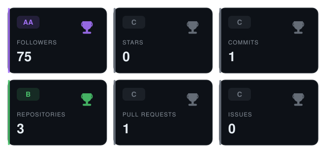
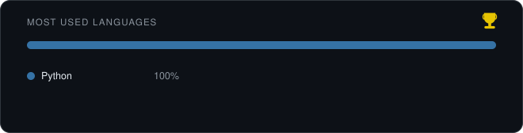

# mb-xrl

Hi, I'm **mb-xrl**.

- 🧑‍💻 Software developer
- 🌱 Open source contributor
- 🔐 Security researcher

I build software, contribute to open source, and dig into security — from code review
and vulnerability research to hardening what I ship.

### Trophies

Self-hosted SVGs generated from the GitHub API by [`scripts/gen_trophies.py`](scripts/gen_trophies.py) — run it to refresh.

### Find me

- GitHub: [@mb-xrl](https://github.com/mb-xrl)

---

Open to collaboration and interesting security problems.
